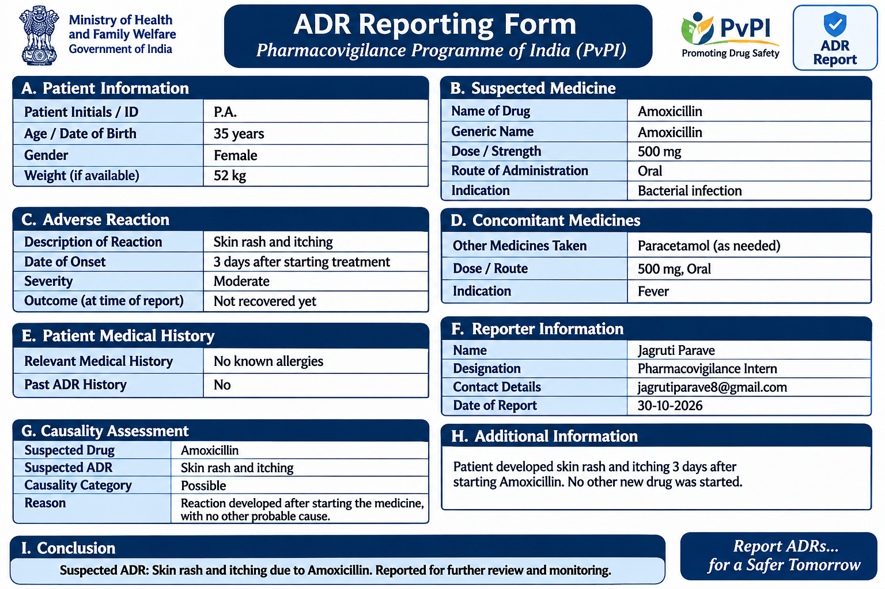

# ADR-Identification-Basics
Task 1 – Pharmacovigilance: Analysis of patient case scenarios to identify suspected Adverse Drug Reactions (ADRs).
ADR Identification Basics

Task 1 – Pharmacovigilance

1. Introduction

Adverse Drug Reactions (ADRs) are unwanted and harmful responses to medicines occurring at normally used doses.

Pharmacovigilance involves the detection, assessment, understanding and prevention of adverse effects related to medicines.

2. Objective

- To understand the concept of ADRs.
- To analyse patient case scenarios.
- To identify suspected drugs.
- To correlate symptoms with medication history and timelines.
- To understand the importance of patient safety.

3. Methodology

1. Review patient demographics and medical history.
2. Check the patient's medication history.
3. Identify signs and symptoms.
4. Establish the timeline between drug administration and reaction.
5. Identify the suspected drug.
6. Assess the possibility of an ADR.
7. Document the findings and reasoning.

4. Patient Case Analysis

Patient cases and detailed ADR assessments will be documented in this section.

5. Key Learnings

- ADRs can occur even at recommended doses.
- Medication history is important in ADR identification.
- Timing helps assess a possible drug relationship.
- Early identification supports patient safety.

6. Conclusion

ADR identification is an important part of pharmacovigilance. Systematic analysis of patient history, symptoms and medication timelines helps identify suspected adverse drug reactions.

7. References

- World Health Organization (WHO) – Pharmacovigilance
- Pharmacovigilance Programme of India (PvPI)
## ADR Reporting Form – Example

- Educational material on ADR identification and pharmacovigilance.
